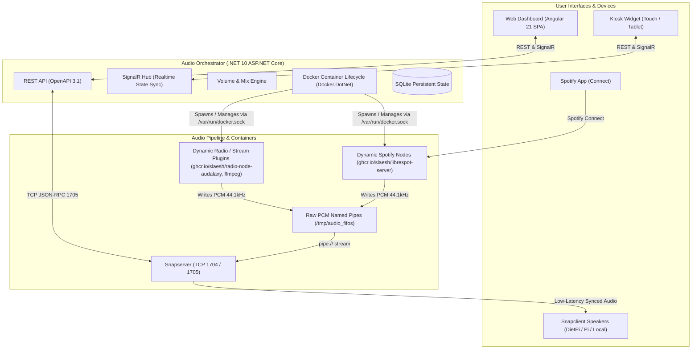

# Audio Orchestrator

[](https://github.com/slaesh/audio-orchestrator/actions/workflows/release.yml)
[](https://opensource.org/licenses/MIT)

Synchronized multi-room audio orchestration system powered by [Snapcast](https://github.com/badaix/snapcast), dynamic [librespot-server](https://github.com/slaesh/librespot-server) containers, and a .NET 10 ASP.NET Core API with an Angular 21 dashboard and kiosk widgets.

---

## Architecture Overview



---

## Features

- **Drag & Drop Room Assignment**: Seamlessly assign physical rooms (Snapcast clients) to synchronized playback groups directly from the web interface.
- **Dynamic Spotify Connect Nodes**: Standalone, containerized Spotify Connect instances powered by [`librespot-server`](https://github.com/slaesh/librespot-server). Each Spotify Connect source is spun up on-the-fly and automatically switches listening groups.
- **Containerized Radio Plugins**: Extensible Docker-based radio handler plugins for rich live song title, artist, and cover art metadata extraction (e.g. Audalaxy / StreamABC for Sunshine Live, with automatic ICY stream metadata fallback).
- **Auto-Discovery & Zero-Config Clients**: Any new Snapclient device on your network appears automatically in the Unassigned Rooms inventory.
- **Bi-Directional Volume & Mix Control**: Full master volume and individual room mix balance controls synced in real time across the web UI, external REST API, and Spotify mobile apps.
- **Kiosk & Touchscreen Widget View**: Dedicated `/widgets/selector` and `/widgets/group/:id` full-screen layouts designed for wall-mounted tablets and home automation displays.
- **Self-Healing State**: All configurations, stream assignments, and volume balances are persisted in SQLite and reconciled immediately after host reboots.

---

## Quickstart

### Prerequisites
- Docker Engine & Docker Compose
- Host `/var/run/docker.sock` accessible to the container

### 1. Initialize Persistent Storage

> [!NOTE]
> Named audio pipes in `/tmp/audio_fifos` are self-healing: the Orchestrator automatically provisions the directory, FIFOs, and permissions (`0666`, UID 1000) on startup, even across system reboots.

You only need to prepare the persistent storage directories for Snapserver and SQLite:

```bash
mkdir -p storage/snapserver storage/orchestrator
# Ensure ownership matches non-root container users (UID 1000)
chown -R 1000:1000 storage
```

### 2. Configure Environment

Copy `.env.example` to `.env` (optional, sane defaults are pre-configured):

```bash
cp .env.example .env
```

### 3. Start the Stack

```bash
docker compose up -d
```

Open `http://localhost:5000` in your browser to access the dashboard!

> **Fedora / SELinux Users**: If SELinux is set to `Enforcing`, `security_opt: [label:disable]` is configured in `docker-compose.yml` to permit container communication with `/var/run/docker.sock` and `/tmp/audio_fifos`.

---

## Configuration Reference

| Environment Variable | Description | Default |
|---|---|---|
| `SNAPCAST_HOST` | Hostname or IP of the Snapserver TCP JSON-RPC interface | `localhost` |
| `SNAPCAST_PORT` | Port for Snapserver TCP JSON-RPC control | `1705` |
| `ORCHESTRATOR_INTERNAL_URL` | Base URL used by dynamic Spotify and Radio containers to reach Orchestrator webhooks | `http://localhost:5000` |
| `FIFO_BASE_DIR` | Host base path for named PCM audio pipes | `/tmp/audio_fifos` |
| `SPOTIFY_NODE_IMAGE` | Docker image tag for Spotify Connect nodes | `ghcr.io/slaesh/librespot-server:0.3.0` |
| `DOCKER_FFMPEG_IMAGE` | Docker image used as fallback for streams without specialized plugins | `jrottenberg/ffmpeg:4.1-alpine` |
| `DOCKER_RADIO_AUDALAXY_IMAGE` | Default Docker image for the Audalaxy radio metadata stream plugin | `ghcr.io/slaesh/radio-node-audalaxy:latest` |

---

## Radio Plugin Contract

You can implement custom radio metadata extractor containers in any programming language. Radio plugins communicate with the Orchestrator via environment variables and an HTTP webhook:

### Container Environment Variables Passed by Orchestrator
- `STREAM_ID`: Unique identifier for the radio stream.
- `STREAM_URL`: HTTP(S) radio audio stream URL.
- `FIFO_PATH`: Filesystem path to the named pipe (`/tmp/audio_fifos/radio_<id>`).
- `WEBHOOK_URL`: Orchestrator webhook endpoint for live metadata updates (`POST /api/internal/radio-events`).

### Webhook JSON Payload
When a song changes, the plugin sends a POST request to `WEBHOOK_URL`:
```json
{
  "streamId": "radio_<id>",
  "title": "Song Title",
  "artist": "Artist Name",
  "coverUrl": "https://example.com/cover.jpg"
}
```

---

## Development & Code Generation

### Hybrid Development Mode
For rapid backend and frontend hot-reloading:
1. Start background infrastructure:
   ```bash
   docker compose up -d snapserver snapclient-local
   ```
2. Run backend in development mode:
   ```bash
   cd apps/orchestrator && dotnet watch run
   ```
3. Run Angular frontend:
   ```bash
   cd apps/orchestrator/ClientApp && npm run start
   ```

### Code Generation Scripts
- **Angular API Client**: `npm run generate-api` (regenerates Angular OpenAPI client from build-time spec and maintains Tapper DTO consistency).
- **Spotify Node C# Client**: `npm run generate-spotify-node-client` (updates `SpotifyNodeOpenApiClient.cs` from official `librespot-server` releases).

---

## License

MIT License. See [LICENSE](LICENSE) for details.
